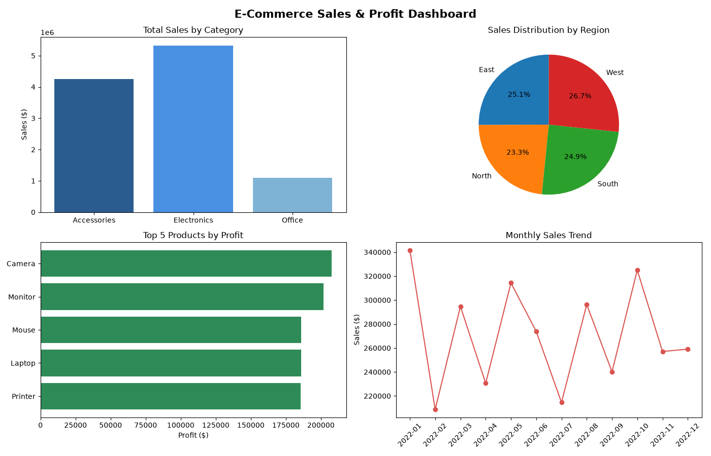

# E-Commerce Sales & Profit Dashboard

## Project Overview
This project analyzes 3,500 e-commerce sales transactions using Python to clean data, calculate key performance indicators (KPIs), and visualize business performance.

## Key Metrics Calculated
- **Total Revenue (Sales):** $10,667,881.00
- **Total Profit:** $1,844,665.21
- **Overall Profit Margin:** 17.29%
- **Total Units Sold:** 17,261
- **Average Order Value:** $3,047.97

## How to Run
1. Install required libraries: `pip install -r requirements.txt`
2. Run the dashboard script: `python3 ecommerce_dashboard.py`
 

 ## Dashboard Preview 
 